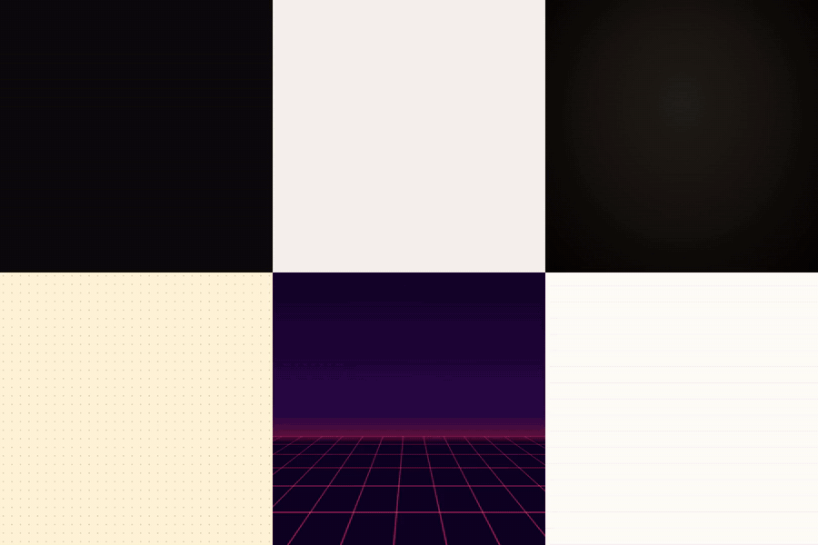
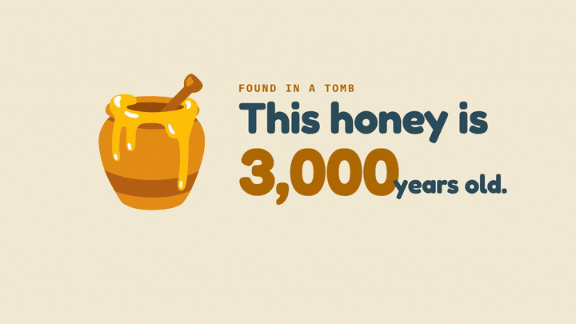
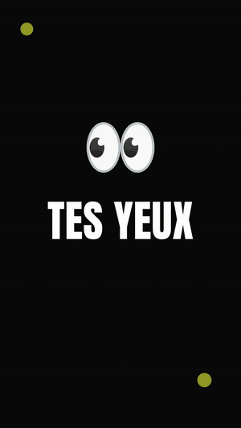

<h1 align="center">idea-to-motion</h1>

<p align="center"><strong>Type an idea, get a motion-design video.<br>
Any topic: a product launch, a birthday, a science fact, a quote, an event, your startup.<br>
Kinetic typography, icons, charts, characters, camera moves, music, sound effects and voice-over: rendered on your machine.</strong></p>

<p align="center">
  
  
  
  
  <a href="./LICENSE"></a>
</p>

<p align="center">
  <a href="assets/styles-reel.mp4"></a><br>
  <sub>One prompt, six styles. <a href="assets/styles-reel.mp4">▶ Watch with sound</a> (each style composes its own music)</sub>
</p>

```text
/idea-to-motion 30-second explainer: why honey never spoils, with a voice-over
```

<p align="center">
  <a href="assets/demo-honey.mp4"></a><br>
  <sub><a href="assets/demo-honey.mp4">▶ Watch the full 27 s video with voice and music</a> · generated from the one line above, no questions asked · <a href="examples/honey-never-spoils">project files</a></sub>
</p>

```text
/idea-to-motion Reels de 15-20 s en français sur la règle 20-20-20 pour les yeux, style énergique, avec voix off
```

<p align="center">
  <a href="assets/demo-reel-fr.mp4"></a><br>
  <sub><a href="assets/demo-reel-fr.mp4">▶ Watch with the French voice-over</a> · 9:16, kinetic style, words on the beat · <a href="examples/regle-20-20-20">project files</a></sub>
</p>

## Two ways to use it

**Say it all, get it now.** If your message holds the essentials, it generates directly:

```text
/idea-to-motion 15 s Reels ad for "Nova", a notes app with offline AI summaries.
                Dark tech style. CTA: join the waitlist at nova.app
```

**Say a little, answer 3 quick questions.** If something essential is missing, it asks once,
multiple choice, with a recommended option, then never asks again:

```text
You:    /idea-to-motion a video for my bakery

Agent:  Three quick choices (or say "you choose"):
        1. Which story?   a) The new croissant (recommended)  b) Opening hours  c) Our 3 best sellers
        2. Where?         a) Reels / TikTok 9:16, 15 s (recommended)  b) Instagram feed 1:1  c) Website 16:9
        3. Which vibe?    a) Paper: warm, handmade (recommended)  b) Editorial: elegant  c) Kinetic: bold

You:    1a 2a, and the croissant costs 1.60 €

Agent:  🎯 "Le croissant au beurre AOP" · social ad · 15 s · 9:16 · paper · warm music
        🎬 s1 0–2.5 hook · s2 2.5–7.5 three layers · s3 7.5–12.5 price stamp · s4 end card
        ✅ s1 … s4 · check: 0 errors · stills reviewed · critic pass: 2 fixes
        ✅ renders/croissant.mp4 · 15.0 s · 1080x1920 · music + effects · 6 MB
```

## What happens

| Step | What the agent does |
|---|---|
| **1. Intake** | Scores your brief. Complete: goes direct. Not: at most 3 multiple-choice questions, in one message. Never asks about fonts, pace or scene count. |
| **2. Facts** | Lists every name, number, date and price that will appear, with its source. Topic videos are fact-checked when web search is available. Missing facts become visible `[PLACEHOLDERS]`, never guesses. |
| **3. Story** | Picks the genre structure (16 genres), one idea to remember, a hook readable at frame 0, and one of 14 styles. Scene lengths snap to the music's bars. |
| **4. Build** | Writes each scene with the MO motion kit: kinetic type, icons and illustrations, charts, timelines, diagrams, device mockups, confetti, camera moves, transitions. |
| **5. Quality loop** | Automatic checks (layout, contrast, reading time, safe areas for Reels/TikTok/Shorts), then the agent **looks at the frames**, and a fresh critic sub-agent reviews them. Up to 3 rounds. |
| **6. Sound** | Composes music for the mood, synthesises sound effects synced to the motion, records the voice-over, mixes and normalises to −14 LUFS. |
| **7. Render** | MP4 + poster, verified (duration, streams, black frames, loudness). |

## What's inside

- **14 styles**, each a full design system: palette, Google Fonts pairing (embedded in the
  render), texture, *and motion character* (easing, speed, overshoot, hand-made frame
  stepping). Flat, dark tech, blueprint, kinetic, editorial, swiss, brutalist, synthwave,
  isometric, paper, doodle, luxury, glass, pastel. Your brand colours and fonts override any of them.
- **The MO motion kit**: 50+ helpers that encode studio timing. Words, letters and masked lines,
  kinetic "punch" on the beat, marker highlights, hand-drawn circles and underlines, scramble,
  counters, bar/line/ring charts, timelines, diagrams with flowing packets, stroke drawing,
  morphing, motion paths, seeded confetti, panel wipes, dives, parallax, karaoke captions.
- **Illustrations without AI images**: 3,000+ Noto colour emoji used as illustrations, Lucide,
  Tabler and Phosphor icons, flags, brand logos (Simple Icons), and Open Peeps characters, all
  permissively licensed and fetched by name.
- **Music that fits the cut**: a procedural composer (8 moods: upbeat, energetic, chill, epic,
  playful, tense, elegant, warm) writes a track to the exact length, lifts into the big reveal
  and resolves on the last frame. The kit can snap hits to its beats. No samples, no licences.
- **Voice-over, offline**: Kokoro (Apache-2.0) via sherpa-onnx, in English, French, Spanish,
  Italian, Portuguese, Japanese, Chinese and Hindi, with word-synced captions and visuals that
  land on the word the voice says.
- **Sound effects** synthesised from what moves: whooshes, pops, impacts, ticks, typing,
  shimmer, scribbles. Music ducks under the voice automatically.

## Install

**Any agent** (Claude Code, Codex, Cursor, Gemini CLI, GitHub Copilot, OpenCode and more),
with the [skills CLI](https://github.com/vercel-labs/skills):

```bash
npx skills add georgesmomo/idea-to-motion
```

**Claude Code plugin:**

```text
/plugin marketplace add georgesmomo/idea-to-motion
/plugin install idea-to-motion@idea-to-motion
```

**Manual:** copy `skills/idea-to-motion/` into your agent's skills folder.

**Requirements:** Node.js 22+. On first use the skill installs a pinned toolchain in
`~/.cache/idea-to-motion` (HyperFrames, a static ffmpeg, GSAP, icon sets; about a minute). The
first render downloads a headless Chrome (~260 MB); the first voice-over downloads the voice
model (~130 MB). Fonts are fetched once from Google Fonts. After that it works offline.
No API key, no account, telemetry off.

## Try these

| Say | You get |
|---|---|
| `/idea-to-motion birthday video for Léa, 30 years old, 12 s, playful` | pastel style, her name in giant letters, confetti, playful music |
| `/idea-to-motion 20 s Reels ad for my climbing gym opening on Dec 6, French voice-over` | kinetic style, 9:16, French voice with captions, date and code on the beat |
| `/idea-to-motion explain how black holes form, 60 s, for teenagers` | researched facts, educational structure, voice-over |
| `/idea-to-motion data story: remote work 12 % (2019) → 58 % (2023), source Gartner` | editorial style, counters, animated bar chart, source line |
| `/idea-to-motion logo reveal for ARKA, luxury, 6 s` | gold on black, stroke-drawn logo, light sweep, cinematic hit |
| `/idea-to-motion "Done is better than perfect." kinetic, square` | the quote above |

Then change anything in plain words: "more punchy", "make a 16:9 version", "add a voice-over",
"try the luxury style", "slower second scene".

## Why this one

- **Any topic, not just product promos.** Genre structures for 16 kinds of video, from a
  birthday to a data story.
- **One line or three answers.** It decides when it knows enough; you never fill a form.
- **Your facts, never invented ones.** A facts ledger with sources; placeholders instead of guesses.
- **It looks at its own work.** Checks, still frames, an independent critic, then a verified render.
- **Sound is part of the design.** Music written to the cut, effects on every meaningful move,
  voice-over with captions, all licence-free.
- **Local and reproducible.** Pinned toolchain, deterministic rendering, plain HTML you can edit.

## Limits (honest)

- No photos, stock footage or AI-generated images (by design: everything is drawn).
  You can add your own images, logos and Lottie files.
- The procedural music is a good bed, not a hit single; bring your own track with `"music": "file.mp3"`.
- Voice-over word timing is interpolated within each sentence (fine for captions, not lip sync).
- Arabic, Hebrew, Chinese, Japanese and Korean on-screen text need a matching font: not bundled yet.
- Rendering runs locally: about 1–3 minutes for 30 s of video.
- Quality depends on the model driving it; it is tuned on Claude.

## Files

```text
skills/idea-to-motion/
├── SKILL.md                 # the 7-phase flow
├── references/
│   ├── intake.md            # when to go direct, which questions to ask, defaults
│   ├── genres.md            # 16 genres: structures, time budgets, hooks, end cards
│   ├── styles.md            # the 14 styles, which one for which brief, brand overrides
│   ├── kit.md               # the MO motion kit API and markup patterns
│   ├── craft.md             # timing, reading holds, type, safe areas, composition
│   ├── sound.md             # effects, generated music and beat sync, voice-over, captions
│   └── qa.md                # quality loop, critic prompt, checklist
├── kit/                     # motion.js (motion helpers) + motion.css (styles)
├── scripts/                 # motion.mjs (CLI), music.mjs, sfx.mjs, voice.mjs
└── template/                # brief, storyboard and facts ledger templates
examples/                    # the demos above, as editable projects
```

## Roadmap

- More example videos per genre, and a gallery page.
- Bundled CJK and Arabic fonts.
- More music moods and instruments; stems for your own edits.
- Optional cloud voices (ElevenLabs) when you have a key.

Made a video with it? Share it in an [issue](../../issues/new?template=showcase.md): it helps
others see what is possible. Ideas, styles and examples are welcome as pull requests.

## Credits

Rendering by [HyperFrames](https://github.com/heygen-com/hyperframes) (Apache-2.0); animation
by [GSAP](https://gsap.com) (free "no charge" licence, installed at setup, not redistributed);
voice by [Kokoro](https://huggingface.co/hexgrad/Kokoro-82M) (Apache-2.0) through
[sherpa-onnx](https://github.com/k2-fsa/sherpa-onnx); icons by [Lucide](https://lucide.dev) (ISC),
[Tabler](https://tabler.io/icons) (MIT), [Phosphor](https://phosphoricons.com) (MIT),
[Noto Emoji](https://github.com/googlefonts/noto-emoji) (Apache-2.0),
[circle-flags](https://github.com/HatScripts/circle-flags) (MIT),
[Simple Icons](https://simpleicons.org) (CC0) via [Iconify](https://iconify.design); people by
[Open Peeps](https://www.openpeeps.com) (CC0) via [DiceBear](https://www.dicebear.com); fonts from
[Google Fonts](https://fonts.google.com) (OFL). Brand logos remain trademarks of their owners.

## Related

- [**tech-to-motion**](https://github.com/georgesmomo/tech-to-motion): the same idea for engineers, from your docker-compose, Terraform or CI.
- [**devops-mock-interview**](https://github.com/georgesmomo/devops-mock-interview): a realistic DevOps / SRE interview with live incidents.
- [**mock-interview**](https://github.com/georgesmomo/mock-interview): the same realistic interview for any job.
- [**spectoflow**](https://github.com/georgesmomo/spectoflow): spec-driven development for any coding agent.

## License

[MIT](./LICENSE) © Georges MOMO

If it saved you an evening in After Effects, a ⭐ helps others find it.
